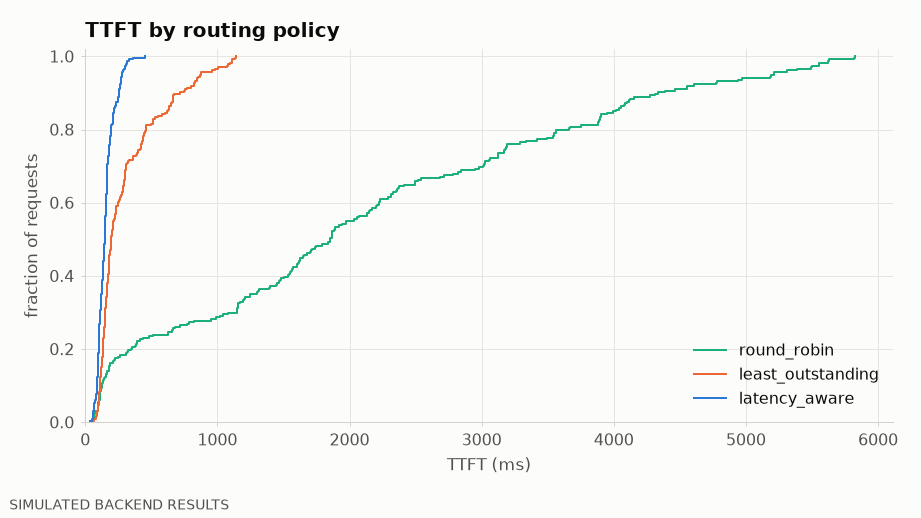
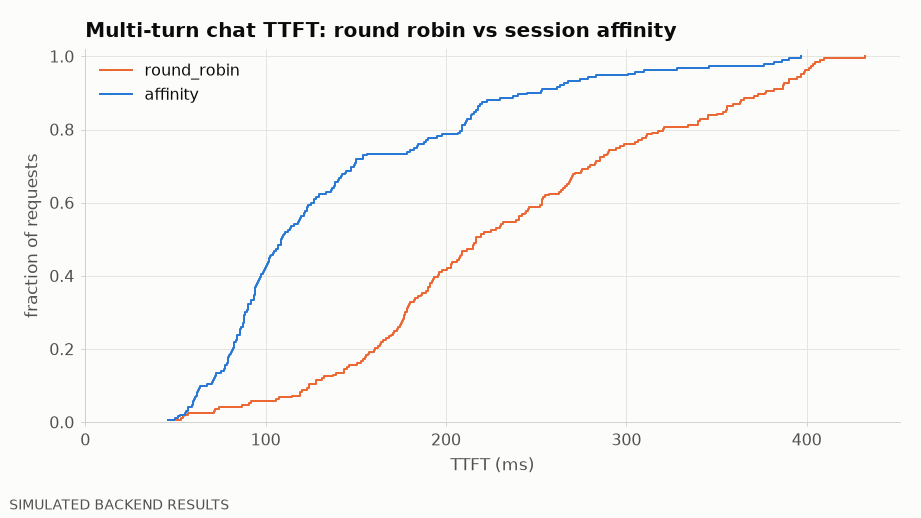

# InferenceLab local demo

> **SIMULATED BACKEND RESULTS** — everything below was produced on a CPU laptop by InferenceLab's simulated engines behind the real gateway over loopback HTTP. The numbers demonstrate gateway behaviour (routing, caching affinity, reliability, admission control, SLO accounting). They are **not** GPU inference measurements and say nothing about vLLM, SGLang or TensorRT-LLM performance.

Mode: full · scenarios: 5 · output: `20261113-205239-demo-eeb4`

Simulated engines: `sim-fast` (12 ms step overhead, 32 sequences), `sim-small` (26 ms step overhead, 2× prefill/decode cost, only 8 sequences — a smaller accelerator), `sim-slow` (as sim-small with 16 sequences); `mock-flaky` is a fixed-latency mock with fault injection.

## 1. Routing policies on a heterogeneous fleet (sim-fast + sim-small, Poisson 20 req/s)

| Policy | TTFT p50 | TTFT p95 | TPOT p95 | Req/s | Output tok/s | Goodput | Traffic share |
|---|---|---|---|---|---|---|---|
| round_robin | 1,855 ms | 5,197 ms | 37.93 ms | 13.36 | 428 | 2.97 | sim-fast 50%, sim-small 50% |
| least_outstanding | 196.1 ms | 871.9 ms | 35.73 ms | 18.92 | 605 | 13.99 | sim-fast 67%, sim-small 33% |
| latency_aware | 146.9 ms | 275.5 ms | 33.76 ms | 19.89 | 636 | 19.80 | sim-fast 74%, sim-small 26% |

Measured: highest goodput with **latency_aware** (19.80 req/s vs 2.97 req/s for round_robin).
TTFT p95 from best to worst: latency_aware 276 ms, least_outstanding 872 ms, round_robin 5197 ms.
Round robin sends half of the traffic to the small engine regardless of its backlog; load-aware policies (fewest in-flight requests, peak-EWMA latency × load) route around it. Compare the traffic-share column with the latency columns.

## 2. Session affinity on multi-turn chat (2 identical engines with prefix caching)

| Routing | Engine-reported cached input | TTFT p50 | TTFT p95 | Req/s |
|---|---|---|---|---|
| round_robin | 73.5% | 216.5 ms | 396.8 ms | 15.97 |
| affinity | 81.9% | 108.6 ms | 291.1 ms | 18.32 |

Each turn resends the whole conversation. With affinity (rendezvous hashing on `conversation_id`, bounded load) later turns land on the engine that already holds the conversation's KV blocks, so more of the prompt is served from cache.

## 3. Circuit breaking and bounded retries

error fault injected into mock-flaky at t≈1.5s for 4.0s.

| Client-observed success | Error rate | Gateway retries | Circuit opened | TTFT p95 |
|---|---|---|---|---|
| 170/170 | 0.00% | 5 | 2× | 271.8 ms |

Failures before the first token are retried on the healthy engine (never after output has been streamed); the breaker opens after consecutive failures and probes again in half-open state once the cooldown expires.

## 4. Tenant rate limits (free: 3 req/s, pro: 50 req/s; offered ≈ 8 req/s each)

| Tenant | Sent | OK | Rejected (429) |
|---|---|---|---|
| free | 54 | 20 | 34 |
| pro | 58 | 58 | 0 |

## 5. Backpressure, load shedding and SLO accounting (one sim-slow engine, offered Poisson 40 req/s)

| Throughput | Goodput | Queue-full rejections | Shed (max queue wait) | Gateway queue p50 / p90 | TTFT p95 | SLO |
|---|---|---|---|---|---|---|
| 9.79 req/s | 1.10 req/s | 266 | 69 | 1,360 / 1,484 ms | 2,435 ms | FAIL |

The queue is bounded (16 executing + 24 waiting, 1.5 s max wait): excess load is rejected quickly with 503 instead of queueing without bound, so admitted requests keep a bounded latency. Throughput and goodput are reported separately.

## Plots

## Per-run reports (local `results/` directory; request-level data is not committed)

- routing / round_robin: `20261113-205239-demo-routing-round-robin-38b0/report.md`
- routing / least_outstanding: `20261113-205259-demo-routing-least-outstanding-4f1f/report.md`
- routing / latency_aware: `20261113-205314-demo-routing-latency-aware-8de8/report.md`
- affinity / round_robin: `20261113-205327-demo-affinity-round-robin-1b85/report.md`
- affinity / affinity: `20261113-205341-demo-affinity-affinity-999e/report.md`
- circuit / with-fault: `20261113-205352-demo-circuit-breaker-20d7/report.md`
- rate_limits / tenants: `20261113-205402-demo-rate-limits-4cb3/report.md`
- backpressure / overload: `20261113-205410-demo-backpressure-884d/report.md`
